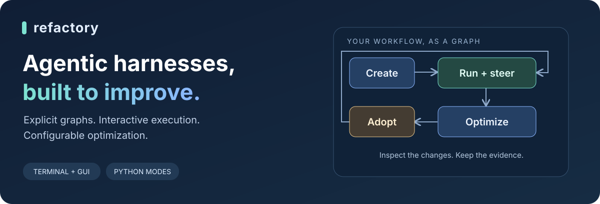
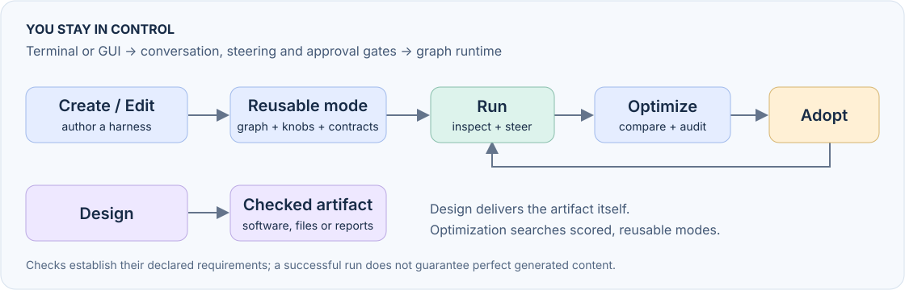

# Refactory



**Create a workflow. Run it interactively. Optimize the way it works.**

Refactory turns agentic work into reusable **modes**: explicit graphs of coding agents, deterministic operations, checks and approval gates. Drive them from a terminal or browser, steer work as it runs, and search their prompts, graph structure and parameters with a configurable outer loop.

[Get started](refactory/docs/getting-started.md) · [Terminal & GUI](refactory/docs/interfaces.md) · [Command reference](refactory/docs/cli.md) · [Write a mode](refactory/docs/tutorials/01-write-a-mode.md)

## What you can build

- **A reusable harness:** Create turns a brief into a package of modes. Bind a Task to work over a class of inputs, or choose a single-run harness.
- **A better version:** Edit produces a new mode package with provenance and honest comparison status.
- **An artifact:** Design builds software, files or reports against a brief and a check command.
- **A measured improvement:** Optimize proposes allowed changes, validates them, evaluates candidates and audits the winner before adoption.



## Why explicit graphs?

The runtime tracks which node is due, executes operations, enforces gates and records the evidence. The conversational CEO delegates agent work and accepts your steering. Skills can help a worker, but **a skill document is not the graph executor**.

The graph and knobs are inspectable data. The optimizer proposes typed changes to those data; the mode's scoring function and declared invariants remain outside that edit surface. A user-owned approval gate belongs to the user.

## Quickstart

Requires Git, [Node.js](https://nodejs.org/) `^22.19` or `>=24`, and [uv](https://docs.astral.sh/uv/). The installer sets up the pinned dependencies, Python environment and DSH profile.

```bash
git clone https://github.com/akashgit/refactory-dsh.git
cd refactory-dsh
./install.sh
uv run refactory list
```

Start with a small **offline** search over a shipped example:

```bash
uv run refactory optimize circle_packing/adaptive \
  --optimizer random --preset knob_only --evaluator walker \
  --epochs 2 --batch-size 4 --max-evaluations 8 --seed 5 \
  --runs-root .factory/loop/first-search

uv run refactory leaderboard --run .factory/loop/first-search
uv run refactory best --run .factory/loop/first-search
```

This example needs no model key. It demonstrates candidate changes, scores and a recorded stopping condition. Use a new run directory for a separate search.

Keep the winner as a new package:

```bash
uv run refactory adopt --run .factory/loop/first-search --as first_tuned
uv run refactory package smoke first_tuned/adaptive
```

The original package remains available. [Continue the walkthrough →](refactory/docs/getting-started.md)

## Choose your interface

| Terminal | Browser |
|---|---|
| `refactory ceo` for conversation and approval gates | CEO chat for authoring and node-by-node interaction |
| `refactory optimize` for explicit search configuration | Modes panel for knobs, search choices and evaluation budgets |
| `status`, `candidate`, `steer`, `adopt` for inspection and control | Run once, attached-run status, Steering and candidate controls |

```bash
uv run refactory ui --port 3081
```

Open the exact URL printed by the server, select the checkout as your workspace, then create a session. Open the right sidebar's **Modes** tab; no introductory chat message is required.

Before model-backed work, save a provider key in **Settings → Models**. Nested workers and validation use the managed credential store; a checkout `.env` or exported key alone is insufficient for those scrubbed processes. `uv run refactory doctor` checks configuration, not authentication or quota. [Model setup →](refactory/docs/models.md)

Try this in GUI chat:

> Open counting_pack/fixed_step with target=20 and step=2. Drive it one node at a time and show me the recorded result.

Or from the terminal:

```bash
uv run refactory ceo counting_pack/fixed_step \
  --knob target=20 --knob step=2 --intent "Count to twenty and explain the recorded result."
```

Chat supports Create, Edit and Design. The Modes panel's ordinary **Start** button launches optimization of a scored mode; **Run once** executes an existing mode. Some attached status and steering views require manual refresh today. [Interface guide →](refactory/docs/interfaces.md)

## Create, edit or design

| Goal | Example |
|---|---|
| Create a single-run harness | `uv run refactory ceo "Draft and check a project README from a supplied brief" --mode create --name readme_pack --single` |
| Create a harness for a class of inputs | Use `--task module:TaskClass` instead of `--single`; see [Tasks and datasets](refactory/docs/datasets.md) |
| Revise a mode | `uv run refactory ceo "Improve the search strategy" --mode edit --revise circle_packing/adaptive --name revised_pack` |
| Build a checked artifact | `uv run refactory ceo "Build wordcount.py and a sample.txt; verify line, word and character counts" --mode design --name wordcount --check "python wordcount.py sample.txt"` |

These commands call a model and can take substantial time. The current full authoring modes include research and reviews; you approve the strategy/design before implementation. Generated packages live in `.factory/packages/`; Design artifacts live in `.factory/artifacts/`. Exact paths and validation outcomes are recorded in the run.

Design produces the artifact itself. It does not need to produce a scored mode or enter the optimizer. [Authoring guide →](refactory/docs/tutorials/03-author-with-a-model.md)

## Optimize with a clear contract

Choose an outer-loop strategy, a candidate proposer, an evaluator and the permitted edits. Set evaluation limits and, for Task-bound modes, a holdout fraction. Inspect each candidate's changes and raw/adjusted scores before adopting.

During a search you can add instructions, keep or reject candidate branches, pause/resume/stop at generation boundaries, and request adoption. A failed or unaudited candidate cannot be treated as a verified winner. A run may finish without finding an improvement.

**Evaluation limits count candidate runs, not tokens or wall-clock time.** Final holdout checks are additional. Different models can change quality, cost and latency. [Optimization tutorial →](refactory/docs/tutorials/02-optimize-it.md)

## Models and coding workers

The current runtime is DSH, built with Cordis. Its coding workers can use configured model providers, including DeepSeek, OpenAI and Anthropic. Selecting an OpenAI model inside DSH does not select the Codex coding agent. The separate DSH evaluator currently uses runtime model defaults; see [routing details](refactory/docs/models.md#model-selection-across-execution-paths).

Codex/Claude Code worker integrations, global budgets and the fast modes below are **planned**, not shipping features. We do not claim equal performance across providers.

## Next release

Every item requires working **CLI and GUI** paths, with separate acceptance evidence.

| Planned improvement | Tracking |
|---|---|
| Shared run budgets and fast Create/Edit/Design modes with light QA | [#234](https://github.com/akashgit/refactory-dsh/issues/234) |
| Live graph/worker visibility, questions and steering | [#235](https://github.com/akashgit/refactory-dsh/issues/235) |
| Saved optimization profiles and complete GUI controls | [#236](https://github.com/akashgit/refactory-dsh/issues/236) |
| Consistent model routing and optional Codex/Claude Code workers | [#237](https://github.com/akashgit/refactory-dsh/issues/237) |

Modes are ordinary customizable graphs. Research and QA are choices in those graphs; proposed fast defaults retain one focused QA stage and bounded repair.

## The command line

The full [command reference](refactory/docs/cli.md) covers authoring, packages, running, optimization, steering and adoption. Use `uv run refactory <verb> --help` for the installed command's options.

## Learn and contribute

| Start here | Go deeper |
|---|---|
| [Getting started](refactory/docs/getting-started.md) | [Architecture](refactory/docs/architecture.md) |
| [Concepts](refactory/docs/concepts.md) | [Python API](refactory/docs/api/index.md) |
| [Tutorials](refactory/docs/tutorials/index.md) | [Tasks and datasets](refactory/docs/datasets.md) |
| [Terminal and GUI](refactory/docs/interfaces.md) | [Verification](refactory/docs/verification.md) |
| [Models and credentials](refactory/docs/models.md) | [Contributing](refactory/docs/contributing.md) |

Refactory is under active development. Execution success, declared check results and the quality of generated content are separate evidence; inspect each when deciding whether an artifact meets your needs.
