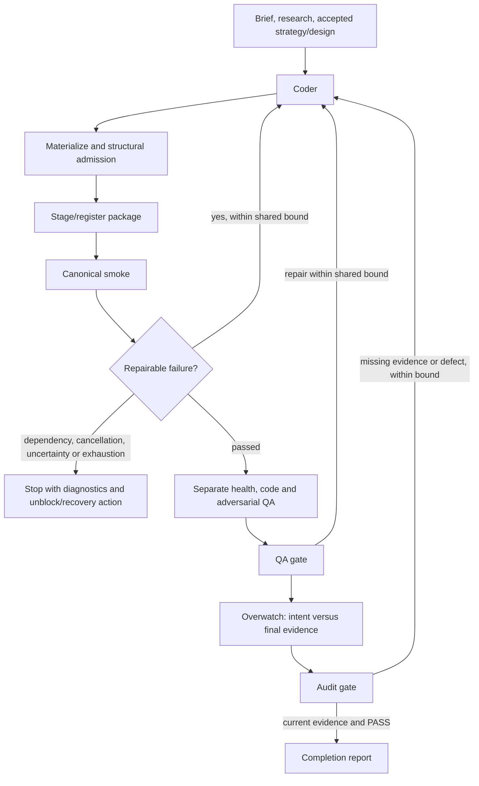
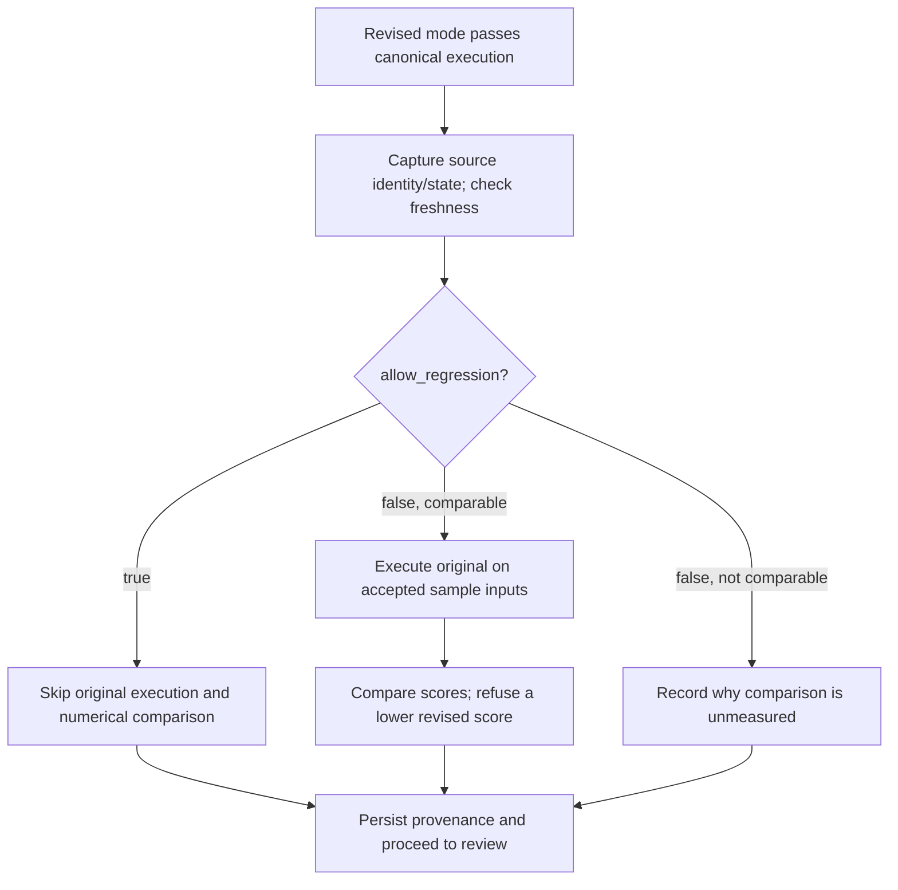

# Authoring validation and intent audits

Create/Edit execute what they built before reviewers sign off. One canonical
runtime operation owns the current revision's smoke, including its generated
score and any model/Task work. Design's declared acceptance command has the same
place in its graph. Listing or registering a package only makes it available for
execution; completion requires successful validation and current review.

Fast Create retains a strategist, coder and one focused QA worker. Fast Edit
retains coder then focused QA. Their smoke now precedes focused QA and shares
`repair_attempts` with structural admission and QA failures. There is no added
Overwatch worker or fan-out. Full Design retains separate health/code/adversarial
reviews and Overwatch after its acceptance command; fast Design retains focused
QA after that command.

## Runtime receipts and repair

`create_ops.gate_smoke` executes `smoke` once for each package attempt. Agent modes
receive a model for that execution; they no longer make a preliminary incomplete
keyless run. `smoke.json` records mode, sample inputs, run directory, status, score
when measured, stdout/stderr, elapsed time and failure information. Distinct smoke
directories preserve the outputs of earlier attempts. `revision.json` separately
records comparison/provenance. Design retains its command and actual output.

`authoring-evidence.json` binds the validation result to hashes of the delivered
source, authoritative brief/strategy/design/plan inputs, applicable ledger entries,
validation settings, receipt files and canonical runtime output files. Each validation receipt also survives in
`.refactory/validation-history/`. Earlier failed or superseded records remain
historical; they cannot certify a repaired revision. This local evidence contract
does not promise exhaustive tracking of external services or every transitive
dependency outside the delivered package.

Repairable implementation/check failures return concrete diagnostics to the
coder. Full modes share their declared attempt allowance across admission,
runtime and review failure; fast modes use their existing total repair allowance.
Missing tools/credentials, cancellation, uncertain worker outcomes/timeouts and
resource exhaustion stop with their actual outcome. The artifact and evidence
remain for explicit unblock/recovery; repeating code generation cannot install an
unavailable validation dependency.

The shared resource ledger accounts for work, validation and repair, including
nested model smoke. Review and completion use the validation allocation; a repair
returns to work admission. Token and elapsed caps remain optional and unset by
default. The repair bound controls attempts, not a fabricated token quota.

## What reviewers and Overwatch receive

The common agent-delivery path supplies the latest ledger and captures the
artifact/context identity at dispatch. Health, code and adversarial QA remain
independent full-mode roles. They inspect canonical receipts and delivered output,
then use targeted checks for uncovered requirements. They do not each repeat the
whole model/Task feed.

Overwatch receives the original brief, accepted strategy/criteria and design,
current applicable ledger, merged reviews and final runtime evidence. It writes
`reviews/overwatch.md` plus `intent-audit.json`. Fast focused QA writes its existing
report plus the same intent map. The map covers every baseline id: `brief`,
`strategy`, explicit `criterion-N` rows when supplied, `design`/`plan`, and current
`ledger-N` instructions, including the initial idea. Compound asks must be decomposed into separate rows even
when they share an id. Each row identifies the requirement, status and supporting
individual file paths with concrete command/output or source findings. Directories,
line-number suffixes and the audit itself cannot serve as evidence references.

Required behavior without adequate evidence is failed or unverified with a
precise reason. A README limitation or reviewer/coordinator waiver cannot alter
the baseline. An exclusion must cite an explicit user change and quote its exact
text (semantic review must still establish that it really authorizes the exclusion). A missing required
consumer or validation tool stays unverified with its exact unblock action.

The gate requires coverage, substantive evidence references, a final exact PASS
verdict without blockers, and current delivery receipts. A changed artifact,
receipt, validation input or later applicable user instruction invalidates old
sign-off. Completion checks freshness again. Explicit graph redo/recovery still
owns restarting completed nodes and archiving dependent state.

These checks establish traceability and freshness. They cannot mechanically prove
that an agent understood every sentence, that a cited command establishes the
claimed behavior, or that a generated artifact is good. Those remain semantic
review responsibilities, tested with actual modeled acceptance as well as controls.

## Edit comparison policy

The default is still false. With true, no original smoke runs, no delta is
computed and the revision is not classified as regressed/non-regressed.
`before_score` and `regressed` are null; `after_score` describes only the revised
measurement. `revision_note` explicitly says comparison was intentionally skipped.
The source state/digest and provenance remain, and revised correctness/QA still
run. With false, existing comparable/non-comparable behavior and numerical refusal
remain. This is not a new evaluation-editing framework or a performance-improvement
requirement.

CEO uses `--knob allow_regression=true`, the Python/headless Edit command uses
`--allow-regression`, chat's Edit tool uses `allowRegression`, and the panel exposes
the declaration's boolean knob and help. All reach the same `_revision` operation;
historical report fields stay readable.

Implementation: [graphs](../refactory_dsh/create.py),
[fast graphs](../refactory_dsh/fast.py), [operations](../refactory_dsh/create_ops.py),
[evidence contract](../refactory_dsh/authoring_evidence.py),
[delivery](../refactory_dsh/agent_delivery.py),
[controls](../tests/test_authoring_evidence.py).

The [2026-09-27 acceptance record](authoring-validation-acceptance-20260927.md)
separates successful terminal/chat runs, the panel's negative control, incomplete
full-chat attempts, measured usage and deterministic coverage.
