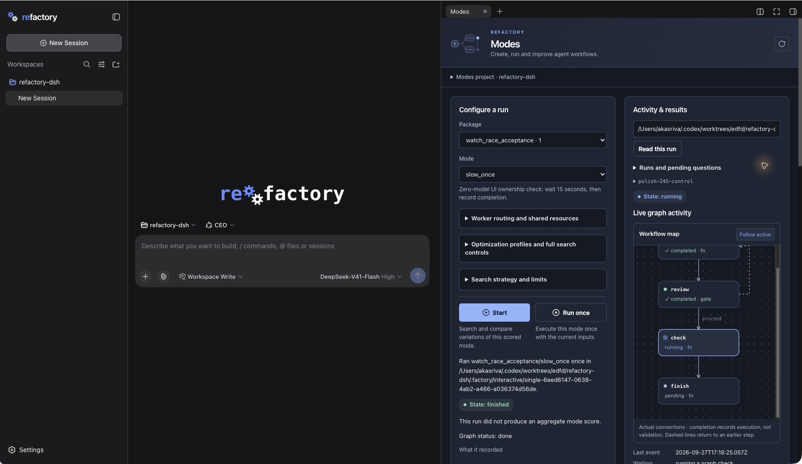

# Panel and branding validation — 2026-09-27

This is the presentation acceptance for #245, based on main `5d4df6482478948db0d6ff62b307190738f1583a`. It reuses [release validation](release-validation-20260926.md) for the unchanged execution contracts in #234–#237 and PR #244. All new native runs were small deterministic fixtures, with **zero model calls**. Historical model-backed runs were read only. No historical campaign was restarted and no new universal resource cap was introduced.

## Result

The original Refactory two-gear artwork now has transparent, theme-aware ink. Brand blue drives the panel, controls and status graphics. The initial HTML, favicon, manifest, welcome, sidebar and blank conversation identify Refactory; the blank conversation's stock headline and Preview badge are removed. Provider/model identities remain accurate.

The panel starts with **Package → Mode**, retaining the full package/mode ID at dispatch. Configuration, activity, steering and package management have distinct sections. Advanced controls fold without unmounting their values. A read-only workflow map renders actual checkpoint nodes and connections, including forks, joins and return edges. Running nodes pulse; waiting, paused, failed, completed and explicitly skipped nodes have text labels. Follow active can be disabled, nodes support keyboard inspection, and reduced-motion preferences disable animation. Old runs without topology keep their recorded-node list. Completion is execution evidence, not a claim that validation passed.

The intended hierarchy was shown before broad implementation, then refined using the owner's explicit direction to retain the two gears and blue identity, remove the logo background and add the two dropdowns and live graph. The captures below show the implemented native application, not the design mockup.

## Native evidence

Captured in Chrome against separate disposable DSH homes: baseline on port 3096, updated application on 3095, and a fresh updated launch on 3097. Images crop away browser chrome and unrelated tabs; application pixels are otherwise unmodified. The animation is a sequence of native screenshots, not a simulated graph.

| State | Before | After |
|---|---|---|
| Fresh welcome | [Upstream welcome](assets/panel-20260927/before-welcome.png) | [Refactory welcome](assets/panel-20260927/after-welcome-light.png) |
| Configured panel | [Expanded light](assets/panel-20260927/before-configured-light-expanded.png) | [Narrow light](assets/panel-20260927/after-configured-light-narrow.png), [narrow dark](assets/panel-20260927/after-configured-dark-narrow.png) |
| Pending question | [Original gate](assets/panel-20260927/before-question-light-expanded.png) | [Question banner and waiting map](assets/panel-20260927/after-live-map-question-dark.png) |
| Active execution | [Recorded activity](assets/panel-20260927/before-active-light-expanded.png) | [Active workflow map](assets/panel-20260927/after-live-map-active-dark.png), [actual node pulse](assets/panel-20260927/live-node-pulse.gif) |
| Completed execution | [Completed graph](assets/panel-20260927/before-completed-light-expanded.png) | [Completed map](assets/panel-20260927/after-live-map-completed-dark.png) |
| Saved failure | [Known failed validation](assets/panel-20260927/before-failure-light-expanded.png) | [Failure in narrow dark layout](assets/panel-20260927/after-failure-dark-narrow.png) |

Additional evidence: [package-scoped mode menu](assets/panel-20260927/after-package-modes-dark.png), [Chinese shell and light theme](assets/panel-20260927/after-locale-zh-light.png), [one run finishes while another remains watched](assets/panel-20260927/after-watch-isolation-dark.png).

## Control and behavior parity

| Contract retained | Evidence for this change |
|---|---|
| Package/mode selection, disabled package Enable, declared knobs, full/fast authoring | Package menu enumerated the catalogue; `default_pack` showed only its six modes. Component tests cover package changes, exact mode IDs and the existing enabled/action guards. Catalogue and execution declarations are unchanged. |
| Run once versus optimization Start | Native `counting_pack/fixed_step` Run once used `step=2,target=7`, produced `value=8,steps=4`. Start used one epoch, one candidate and one evaluation with the existing random/walker settings. UI launch guard and tests prevent a duplicate pending Start; Run once keeps its independent guard. |
| Configuration, profile versions and routing | Native profile `polish-245-demo`, version 1, was saved/selected. Values survived disclosures, resize and light/dark/locale switches. Component tests retain input DOM identity and values. Profile/fast CLI regression tests passed. No routing precedence, permissions or saved schemas changed. |
| Live reads, reconnect and ownership | Watch/Read attaches an existing directory and receives durable state without executing it. The deterministic 15-second run `single-6eed6147-0638-4ab2-a466-a036374d56de` completed while `polish-245-control` stayed watched with its question intact. Stream tests cover late launches/results and retired reads. A targeted test covers Watch changing while Start's receipt is pending, including releasing the launch guard. |
| Questions, steering and graph controls | Native `polish-245-control` used the actual spine: prepare → user review → 30-second check → finish. The question banner linked to the native verdict controls. Pause/resume/stop and explicit correction preview were exercised at supported boundaries. A confirmed correction reran prepare at revision 2 and required a fresh gate answer. The final map followed waiting → running → completed. |
| Correction and recovery safety | Preview still displays invalidated results before confirmation; the real checkpoint was explicitly resumed by the deterministic fixture owner. No graph editor or alternate engine was added. Graph controls retain their run-keyed component and capability semantics. |
| Candidates, adoption/replay, usage and validation | Existing candidate, measurement, validation, adoption/replay and resource components remain reachable. Reuse the release acceptance for unchanged model-backed operations. No inferred percentages, aggregate scores or estimated usage were added. Missing usage remains unavailable. |
| Package import/enable/disable/remove | Existing handlers, arguments and package rows retained under Packages of modes. Package selection only changes local picker state. |
| Layout, focus and accessibility | Actual narrow (~403 px) and expanded (~790 px) panel, both themes, keyboard focus and native selectors inspected. Form state persisted. Long paths wrap in details and remain inspectable; notices and pending questions remain prominent. Graph nodes are keyboard buttons with full names/states; pulse is disabled by `prefers-reduced-motion`. |

Native fixture run paths belong to the isolated checkout's ignored `.factory` directory. The saved failed validation was only viewed, from the earlier release evidence; its defect was neither hidden nor rerun. Logs and authentication URLs are private test artifacts and are not committed.

## Branding and portability audit

| Surface | Verification |
|---|---|
| Initial document title, favicon, manifest | Fresh updated host response and native fresh launch; host-hook tests retain scripts and replace only app identity. The gear favicon was confirmed on the fresh process. |
| Sidebar and empty conversation | Native new session, both themes and English/Chinese locale; original gears and lettering retained, background removed, stock headline/badge absent. |
| Welcome | Native fresh English welcome; English and Chinese injected copy tested while retaining original component, acknowledgement and controller props. |
| Settings, notices, loading and errors | Native general/model settings and saved failure; source audit distinguishes product identity from provider/model/backend and package identifiers. Local loading/error presentation identifies Refactory. |
| Title changes and lifecycle | Tests retain session prefixes, replace only the exact product suffix, and dispose observers, slot contributions and styles. |
| Dependencies and extension boundary | Root DSH pin, workspace patch declarations and all eight existing compatibility patches unchanged. Frozen install and normal build succeed. Local host index/routes, browser slots/theme and read-only Python status supply all changes. |

There is no vendored upstream fork and no new patch. The install already had eight compatibility patches, so it should not be described as literally patch-free. See [upstream compatibility](upstream-compatibility.md) for upgrade checks, including the two isolated title/hero presentation bridges.

## Automated checks and remaining limitations

- Frozen offline install passed; host/client typechecks and production build passed.
- GUI tests: **156 passed in 9 files**, including package filtering, disclosure preservation, launch ownership, topology layout, state labels, keyboard interaction, branding and both welcome locales.
- Python `test_live_activity.py`, `test_profiles.py`, `test_fast_cli.py`: **56 passed**. Topology coverage checks real edges, forks/joins/return paths, skipped nodes, malformed/old checkpoints, command/prompt exclusion and unchanged checkpoint bytes.
- `pnpm lint` and whitespace check passed. Normal commit and push hooks are required for delivery.
- The broader Python CLI/profile selection had **68 passed, 6 failed**; the same six failures reproduced on the unchanged baseline. They concern stale doctor/catalogue/README expectations and legacy DSH profile stubs, not the UI or graph reader.
- The broader Refactory host selection had **109 passed, 10 failed**. The seven service-unit failures reproduce on baseline (older argv, authoring receipt and ledger expectations). The same three live failures also reproduce on baseline: two outdated unknown-run error strings and a stop/finished-state expectation. No host execution code was changed to suppress these failures.

Some existing advanced controls, runtime state labels and catalogue descriptions remain English when the shell is Chinese; the new package picker and principal panel labels follow the locale. The original logo remains raster-derived, suitable for current app sizes. The launcher still prints the underlying `dsh web` runtime URL label. The title and hero-wrapper bridges need rechecking on an upstream upgrade. This work does not claim a fully green repository-wide historical suite or repeat the completed model-backed acceptance.
