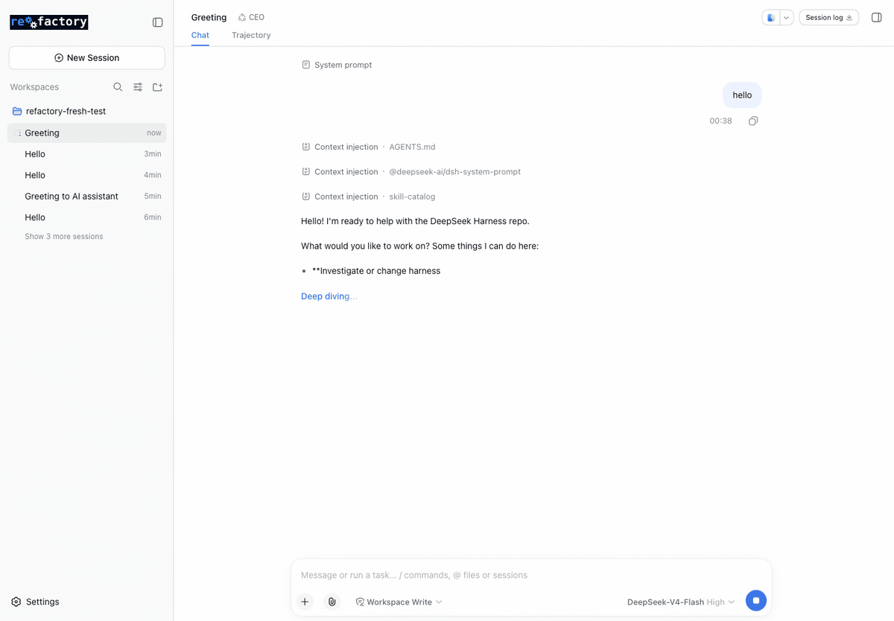

# Pick and watch from the panel

See [Get started](../getting-started.md) for installation and [Terminal and GUI](../interfaces.md) for current interface coverage. The other tutorials use the shell. This one uses the browser, because the panel is
where a person chooses a run rather than composing the command for it: a mode, an
outer loop, an optimizer and an evaluator are all **described choices** read from the
same console the shell and the model use.

What you end with: a run chosen, started and watched from the right Sidebar, and the
same run readable from the shell by the id the panel showed you.

**The panel reads the console, so it is the CLI's surface in a different shape.** If a
choice is not in `uv run refactory modes`, it is not in the picker; if
the console refuses something, the panel shows the console's own reason.

---

## Start the GUI from this checkout

The repository's patched web profile composes the panel built at
`packages/client/ui-refactory/lib/client.js`:

```bash
uv run refactory ui --port 3103 --no-open
```

```
dsh web: http://127.0.0.1:3103/?token=<per-process token>
```

Open the printed URL, token and all. The token is per-process and the bare
`http://127.0.0.1:3103/` answers `401` without it.

The panel needs the same checkout the rest of these tutorials use: the bundle row
resolves `repoRoot` from the directory the server starts in, and the console it runs
is `.venv/bin/python -m refactory_dsh.console`.

## Open the panel



1. **Pick the workspace.** The app remembers one; a fresh profile starts with the
   workspace list empty and asks you to add a directory. Choose this repository.
2. **Select New Session.** Its panel entry is available while the conversation is
   still blank; opening the panel does not require a message or a model call.
3. **Press the expand control** at the top right of the conversation (its tooltip
   is `Open the sidebar`), then the **Modes** tab.

The panel is the right Sidebar's own tab, beside the files view, so it keeps its place
while you read the conversation.

Each CEO chat owns its own `wf_open` run. You can leave one chat paused at a
review gate and drive another mode in a different chat; state, edits and steering
stay with the calling session. A session must finish its current run before
opening another. Use distinct run directories across sessions (omitting `workdir`
derives one from the session); overlapping directories are refused before lowering,
including a completed run another session still has open for inspection.

## What each control does

| control | what it does | the console call behind it |
|---|---|---|
| **Mode** | every mode the console lists, each with the verb that runs it | `console modes` |
| **Outer loop**, **Optimizer**, **Evaluator** | the three level-two registries; each entry carries the console's own description, and `Use the default` leaves the console's default in place | `console strategies` |
| **The mode's knobs** | one field per knob the chosen mode declares, shaped by the kind it declares: a knob with declared values is a choice, a `bool` is a choice over `true`/`false`, a number is bounded by its declared range, an open `str` is text. What the fields show is what the run sends, including a knob left at its declared default | `console start <mode> --knob NAME=VALUE` |
| **Search budget** | epochs, candidates per epoch and maximum candidate evaluations; invalid values disable Start. These are search settings, separate from mode knobs. Final holdout checks are additional; these are not token/time limits | `console start <mode> --epochs … --batch-size … --max-evaluations …` |
| **Start** | starts the chosen mode in its own process and names the run it began | `console start <mode> --strategy … --optimizer … --evaluator … --knob …` |
| **Run once** | shows a unique run directory during launch, then reports the run's own status, due nodes and facts; **Watch and steer this run** attaches its live status and ledger | `console run <mode> --workdir <unique-directory> --knob NAME=VALUE` |
| **Run status** | one frame of the run being read — state, best score, evaluations; **Refresh status** reads the next frame, **Stop the run** asks it to stop | `console status --run <id>`, `console stop --run <id>` |
| **Existing run directory → Read this run** | attach the exact directory reported by CEO chat or the terminal; read its status and steer its ledger | `console status --run <directory>`, `console steer --run <directory> --gates` |
| **Packages of modes** | per package: **Enable**, **Disable**, **Remove**, and **Import a package** from a directory or git URL | `registry list`, `enable`, `disable`, `remove`, `import` |

Behaviours to know before you press something:

- **Controls appear as they become usable.** The section headings are always there,
  but **Start** and **Run once** appear once a mode is chosen, and **Refresh status** and **Stop the
  run** appear once a run is being read. A panel that looks short is waiting for a
  choice, not broken.

- **Disabled packages offer Enable.** Their run buttons are disabled, and enabling
  the package refreshes its modes. An authoring mode instead names its own action;
  Start is disabled and Run once is absent for it.
- **A run stopped at a gate is reported as stopped.** When a run reaches a gate a
  person owns, **Run once** says so, names the nodes still due, and stops: the panel
  does not choose a verdict. Attach the run directory to record a verdict in
  Steering, then ask the CEO to continue. Graph runs show notes and gates, while
  optimizer candidate and control buttons remain specific to optimizer searches.
- **Task grades are separate from a mode score.** A completed run shows recorded
  per-item pass/fail counts when present. If no aggregate mode score was produced,
  the panel says so; it does not invent an average or keep promising a future score.
- **A one-shot has its own identity while it works.** Its path appears while preparing; **Watch and steer this run** becomes available once the fresh graph is durable. That button selects the run for the status and Steering sections. Launching it does not redirect a different run you deliberately attached. The same owned console call returns its final result or refusal; ending its stream requests cancellation through the runtime's subprocess owner. Preparation alone does not certify model authentication or success.
- **Status is read on demand.** There is no poll timer, so a long run does not
  animate; press **Refresh status** when you want the next frame.

## The run the panel started is an ordinary run

The frame names the run it is reading, in full. Copy that path and read it from the
shell — the same commands the other tutorials use:

```bash
uv run refactory status --run /tmp/tour2/run
```

```json
{
  "run_id": "run",
  "root": "/tmp/tour2/run",
  "mode": "counting_pack/fixed_step",
  "state": "finished",
  "events": [
    {"step": "init", "epoch": 0, "generation": 0, "evaluations": 0, "population": 4,
     "epochs": 1, "batch_size": 4}
  ]
}
```

```bash
uv run refactory leaderboard --run /tmp/tour2/run
```

```json
[
  {"id": "e76f85ded100", "parent": "30b45d283597", "score": 1.0,
   "edits": [{"op": "set_knob", "name": "target", "value": 6}],
   "structural": false, "exit_ok": true}
]
```

And the winner becomes a mode of its own, exactly as it would from the shell:

```bash
uv run refactory adopt --run /tmp/tour2/run --as my_tuned
```

```json
{
  "package": "my_tuned",
  "mode": "my_tuned/fixed_step",
  "adopted_from": "counting_pack/fixed_step",
  "candidate": "e76f85ded100",
  "score": 1.0,
  "package_root": "<checkout>/.factory/packages/my_tuned"
}
```

`registry smoke my_tuned/fixed_step` then reports `exit_ok true, score 1.0` — the run
the panel started left the same artifacts, and the same read-back works, because both
surfaces run one process boundary.

## Choosing from the shell first, when that is easier

The panel is a picker over JSON you can read yourself, which is the fastest way to find
out what is on offer before opening a browser:

```bash
uv run refactory modes | head -14
```

```json
[
  {
    "id": "adopted_exact/exact",
    "package": "adopted_exact",
    "description": "establish closed forms of sums with sympy and score what checked out",
    "startable": true,
    "action": "start",
    ...
  }
]
```

`startable` and `action` are what the panel reads to decide whether a mode is a run
(`start`) or an authoring verb (`create`, `edit`, `design`).

---

## Where the panel fits

- **The shell** — [Optimize it](02-optimize-it.md) — the loop, its report, and a
  candidate's diff.
- **The conversation** — [Drive it from the GUI](05-drive-it-from-the-gui.md) — the
  same acts asked for in words, which the CEO performs with the `refactory` tool.
- **Authoring** — [Author with a model](03-author-with-a-model.md) — `create`, `edit`
  and `design`, which the panel deliberately does not start.
- **A person at a gate** — [Run it with a person](06-run-it-with-a-person.md).
- **Datasets** — [Datasets and Tasks](../datasets.md) — a mode that iterates items,
  and the Task that supplies and judges them.

## When the panel is not there

- **Nothing appears in the Sidebar.** The profile in force does not compose
  `@deepseek-ai/dsh-client-ui-refactory`, which is the state of the pinned harness's own
  `web` profile; rebuilding with `pnpm run build` refreshes the artifact but does not
  change the composition.
- **The panel loads but every read fails.** The console could not be reached: the
  message the Host reports carries the console's own words and the argv it ran, so
  `uv run refactory modes` by hand from the same directory reproduces it.
- **A package you just imported is missing.** Press the reload control at the top of
  the panel; the catalogue is read once per open.
